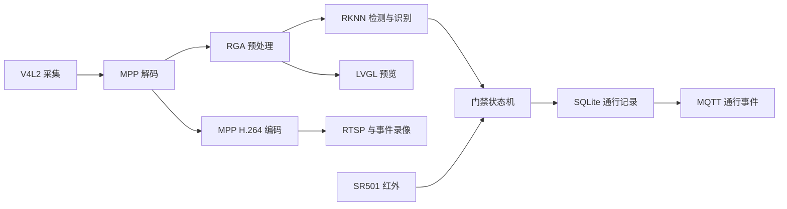
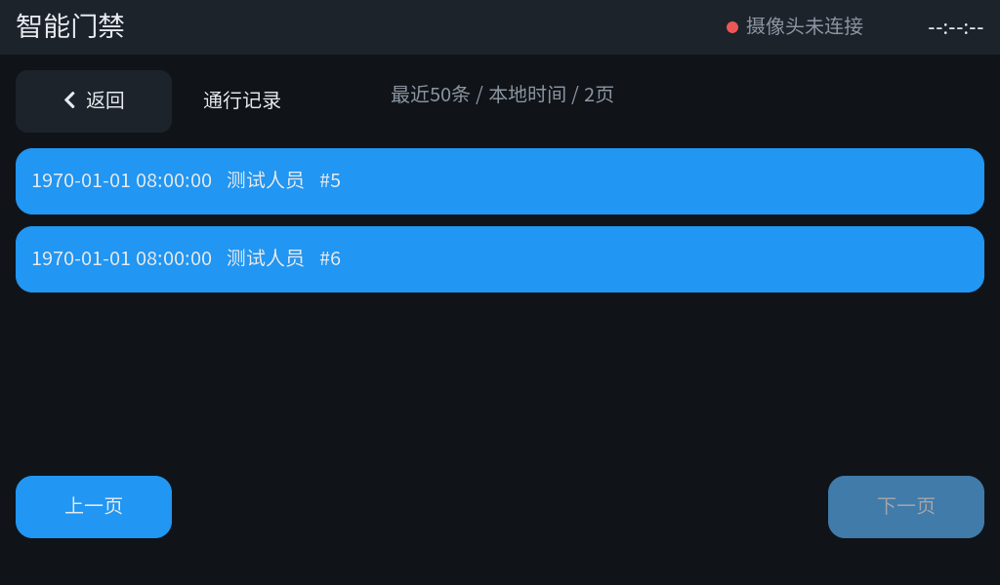

# rk3588-security

基于 Orange Pi 5 Ultra（RK3588）的嵌入式 Linux 门禁与安防终端。本地处理摄像头画面，提供人员检测、人脸识别、模拟开门、事件录像和远程状态上报。

## 已实现

- **视频链路**：V4L2 采集与断线重连，DMA-BUF 交给 MPP 解码，经 RGA 缩放后送入 RKNN。LVGL 在本地显示预览。
- **安防监控**：MPP H.264 编码、RTSP、陌生人事件录像及预录，支持命令行查询和导出录像。
- **门禁**：SR501 通过 libgpiod 输入，识别通过后模拟开门，SQLite 保存通行和快照。触摸屏提供状态、通行列表、翻页和元数据详情。
- **MQTT**：在线、红外和通行事件上报，支持用户名密码认证、TLS、自动重连和有界队列。[配置说明](docs/mqtt.md)

板上已验证本人通行、在场去重、离开再进与最小门禁提示。MQTT 在临时 TLS Broker 上验证，正式 Broker 地址与凭据按部署环境配置。原开发版本基线为 `8e9a774`，该功能基线在原开发仓库通过板上 351 项回归。[云端 CI](https://github.com/Chen-anP/rk3588-security/actions/runs/42953116953)

## 数据流



## Release 实测

| 工况 | 板上结果 |
|---|---|
| 720p MJPG 纯采集 600 秒 | 平均 19.29 fps，后段约 24.9 fps。驱动丢帧 6，USB 重连 1 次并恢复。 |
| 720p 单线程检测 120 秒 | 24.4 次检测/秒，采集到检测结果 P50/P99 为 58.7/62.3 ms，进程 CPU 平均为单核的 16%。 |

检测短测关闭人脸识别和录像。完整环境、指标口径及复现命令见 [性能记录](docs/bench.md#第-10a-步-release-基线2026-11-11)。

## 使用边界

当前门禁动作是模拟授权，实机演示使用 SR501 与屏幕。活体检测、实体门锁、录像回放页和量产部署仍待完成。摄像头曾发生 USB 断连，程序支持重连。短测记录和可复现条件见 [性能记录](docs/bench.md)。

## 硬件与环境

| 项目 | 版本 |
|---|---|
| 板子 | Orange Pi 5 Ultra（RK3588，16 GB，eMMC） |
| 系统 | Orange Pi 1.0.2 Jammy（Ubuntu 22.04），内核 6.1.99-rockchip |
| NPU | 驱动 0.9.8，librknnrt 2.3.2 |
| 模型转换 | rknn-toolkit2 2.3.2（x86_64 / WSL2 Ubuntu 22.04 / Python 3.10） |

实测环境说明见 [docs/environment.md](docs/environment.md)。

新板子刷好官方镜像、配好 SSH 密钥后，在板子上：

```bash
sudo tools/provision/provision.sh --dry-run   # 先看会改什么
sudo tools/provision/provision.sh             # 装机，最后自动跑 board_check.sh
```

模型在电脑上转换、部署，见 [tools/model-convert/README.md](tools/model-convert/README.md)。

## 编译与测试

需要 Ubuntu 22.04（板子或 x86 都可以）。界面库 LVGL 在第一次配置时从 GitHub 下载（版本锁定，见 `cmake/Lvgl.cmake`）：

```bash
sudo apt install -y cmake ninja-build g++ g++-12 libgtest-dev clang-format clang-tidy shellcheck \
  libgpiod-dev libmosquitto-dev libdrm-dev libturbojpeg0-dev libsqlite3-dev \
  libavformat-dev libavcodec-dev libavutil-dev \
  libgstreamer1.0-dev libgstreamer-plugins-base1.0-dev libgstrtspserver-1.0-dev \
  gstreamer1.0-plugins-base gstreamer1.0-plugins-good gstreamer1.0-plugins-bad
# 界面模拟器另需 libsdl2-dev。

cmake --preset debug               # 配置
cmake --build --preset debug       # 编译
ctest --preset debug               # 单元测试
./build/debug/src/rk3588-security --version

tools/check_code.sh                # 提交前自查：格式、静态检查、shell 脚本、私钥
tools/check_code.sh --fix          # 自动重排代码格式
```

| 预设 | 用途 |
|---|---|
| `debug` | 日常开发 |
| `release` | RelWithDebInfo，测性能、发布 |
| `asan` | AddressSanitizer + UndefinedBehaviorSanitizer |
| `tsan` | ThreadSanitizer（用 GCC 12 编译，GCC 11 的 TSan 有误报，见 D15） |
| `ci` | 警告当错误，CI 使用 |

每次推送由 GitHub Actions 在 Ubuntu 22.04 上编译、测试、检查（`.github/workflows/ci.yml`），并生成每个界面页面的截图（Artifacts 里的 ui-snapshots）。

## 运行（板子上）

先完成模型部署，在本地配置里填写摄像头、模型和 SQLite 路径。实体 GPIO 与触摸配置见 [门禁联动](docs/access-integration.md) 和 [SR501 接线](docs/hardware-sr501.md)。MQTT 凭据和 CA 文件按 [MQTT 说明](docs/mqtt.md) 配置。

```bash
cmake --preset release -DRKSEC_WITH_MPP=ON -DRKSEC_WITH_RGA=ON -DRKSEC_WITH_RKNN=ON
cmake --build --preset release -j4
```

```bash
B=./build/release/src/rk3588-security
C=config/rk3588-security.conf
$B -c $C --check-config          # 检查配置文件
$B -c $C --capture-test 300      # 采集自测：帧率、延迟、丢帧
$B -c $C --capture-run 600 2>&1 | tee -i /tmp/rksec-capture.txt
$B -c $C --access-run 120        # 无屏门禁联动
$B -c $C --passes 10             # 只读查看通行记录（含登记姓名）
$B -c $C --ui                    # 屏幕上运行界面（预览 + 触摸），Ctrl+C 结束并打印性能报告
$B -c $C --ui-bench 30 --busy 8  # 只渲染界面（不接摄像头和屏幕），测界面开销；--busy 模拟 CPU 被推理占满
$B -c $C --decode-bench 100 --save /tmp/mpp.ppm  # MPP 硬件解码 vs CPU 解码：耗时、CPU 占用、结果是否一致
$B -c $C --rga-bench 100 --save /tmp     # MPP 解码 + RGA 转 NPU 输入（letterbox）和预览：耗时、结果是否一致
```

## 电脑上的界面模拟器

改界面不用每次上板子：同一套界面代码在电脑上用 SDL 窗口运行，鼠标当手指，摄像头换成移动的假画面。
找到 SDL2 时自动编译 `rk3588-security-sim`（WSL2 需要 Windows 11 的 WSLg 才能显示窗口）：

```bash
sudo apt install -y libsdl2-dev
cmake --preset debug && cmake --build --preset debug
./build/debug/src/rk3588-security-sim                 # 关窗口或 Ctrl+C 结束，打印界面帧率和一帧耗时
./build/debug/src/rk3588-security-sim --busy 8        # 同时占满 8 个线程，看界面卡不卡
./build/debug/src/rk3588-security-sim --scale 2       # 高分屏上放大
./build/debug/src/rk3588-security-sim --headless --seconds 10 --auto-nav   # 没有图形界面时
```

界面的中文字体是事先生成的位图（只含界面用到的字）。界面加了新字后运行 `tools/fonts/gen_fonts.sh` 重新生成，
单元测试 `UiText.EveryCharacterIsInTheFont` 会提醒。

## 目录

```
cmake/           编译选项、版本信息生成
src/core/        基础库：版本、配置、日志、有界队列、帧句柄、阶段计时
src/capture/     V4L2 摄像头采集（系统调用在接口后面，单元测试用假设备）
src/display/     DRM/KMS 显示输出：按驱动名选卡、沿用内核当前模式、双缓冲翻页
src/media/       图像：CPU 解码 MJPG（第 4 步）；MPP 硬件解码、RGA 缩放和颜色转换、dma-heap 内存（第 5 步，硬件部分只在板子上编译）
src/ui/          LVGL 界面：页面、导航、字体、最新一帧信箱
src/app/         主程序（--capture-test、--capture-run、--ui、--ui-bench）
src/sim/         电脑上的界面模拟器（SDL 窗口）
config/          出厂配置文件
tests/           单元测试（GoogleTest）、装机脚本测试
docs/            需求、环境、设计决策、调试记录、性能记录
models/          模型清单（模型文件本身不进 git）
tools/           板级自检、代码检查
tools/provision/ 装机脚本：新板子一条命令装成标准环境
tools/model-convert/  模型转换、部署（电脑上运行）
tools/fonts/     界面中文字体生成
```

## 文档

- [环境清单](docs/environment.md)
- [设计决策](docs/decisions.md)
- [性能记录](docs/bench.md)
- [模型清单](models/MODELS.md)
- [通行记录界面](docs/access-ui.md)
- [MQTT 配置与测试](docs/mqtt.md)

## 界面预览

通行列表，使用合成数据。



## 署名

chen

[第三方来源与许可说明](THIRD_PARTY_NOTICES.md)
